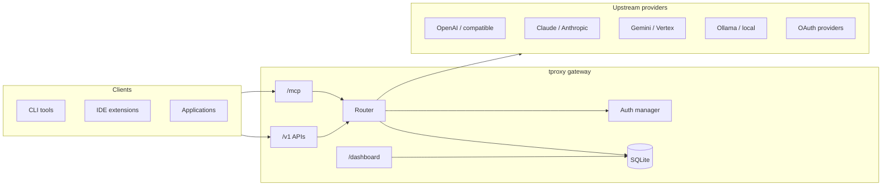

# tproxy

**Self-hosted AI gateway with stable model IDs, multi-provider routing, and an embedded control center.**

tproxy sits between your applications and upstream AI providers. Clients talk to a single OpenAI-, Claude-, or Gemini-compatible endpoint; the gateway handles credential rotation, failover, response rewriting, usage tracking, and OAuth enrollment — without changing client configuration when you add or swap providers.

[](https://github.com/ktvdung2812/TProxy)
[](https://www.npmjs.com/package/@ktvdung1606/tproxy)

---

## Table of contents

- [Overview](#overview)
- [Key features](#key-features)
- [Architecture](#architecture)
- [Supported APIs & providers](#supported-apis--providers)
- [Control center](#control-center)
- [Installation](#installation)
- [Quick start](#quick-start)
- [Configuration](#configuration)
- [Client integration](#client-integration)
- [Deployment](#deployment)
- [CLI operations](#cli-operations)
- [Security](#security)
- [Development](#development)
- [Documentation](#documentation)
- [License](#license)

---

## Overview

Modern AI workflows often depend on several providers — OpenAI subscriptions, Claude OAuth, local Ollama, Gemini API keys, Codex, Kimi, Cursor, Kiro, and more. Each has its own SDK, auth flow, model naming, and rate limits.

**tproxy unifies them behind one gateway:**

| Problem | tproxy approach |
|--------|------------------|
| Clients hard-code provider model names | **Public model IDs** with aliases; upstream names rewritten in responses (including SSE streams) |
| One account hits rate limits | **Credential rotation** with cooldown, sticky round-robin, and 18+ scheduling strategies |
| Provider outage blocks your app | **Ordered fallback** across routes, combos, and fusion policies |
| Secrets scattered in env files | **Encrypted SQLite storage** with hashed client API keys |
| OAuth is painful on a server | **Built-in OAuth wizards** (browser PKCE, device flow, provider-specific profiles) |
| No visibility into spend | **Usage, quota, pricing estimates**, request logs, and audit events |

tproxy is designed for **local machines, developer workstations, and single-node servers**. Persistence is SQLite-only — no external database cluster required.

---

## Key features

### Routing & models

- **Public model IDs (PPM)** — define stable names (`td-coder-pro`, `gpt-sol`, …) mapped to one or more upstream targets with priority and weight.
- **Aliases** — expose multiple client-facing names for the same model.
- **Combos** — ordered fallback chains across virtual models.
- **Protocol mapping** — transparent Claude/GPT placeholder routing so tools like Claude Code and Codex keep their native tier names while tproxy rewrites upstream model IDs server-side.
- **Auto-combo resolution** — zero-config presets such as `auto`, `auto/coding:fast`, `auto/reasoning:pro`.
- **Fusion routing** — parallel execution across models with arena-style ranking.
- **Session affinity** — sticky routing with configurable TTL.
- **Measured scheduling** — latency/TTFT, current load, errors, and recent quota drive the latency-aware, capacity-aware, health-first, least-used, and quota-aware strategies.

### Protocol compatibility

- OpenAI **Chat Completions** and **Responses** (including SSE and authenticated WebSocket).
- Anthropic **Messages** and **count_tokens**.
- Google **Gemini** `generateContent` / `streamGenerateContent`.
- Embeddings, image generation/editing, audio (TTS/STT), video jobs, web search, and SSRF-protected web fetch.
- **MCP JSON-RPC** bridge at `POST /mcp`.

### Providers & authentication

- Generic **OpenAI-compatible**, **Anthropic-compatible**, **Gemini**, **Vertex**, and **Ollama** adapters.
- First-party OAuth profiles: **Codex**, **Claude**, **Kimi**, **xAI**, **Antigravity** (Google Cloud Code), **Copilot**, **Cursor**, **Kiro**, and more.
- API-key providers: Tavily search, ElevenLabs audio, image/video aliases, opt-in HTTP plugins.
- **Encrypted proxy pools** (HTTP/S, SOCKS5) bound per provider or credential.
- **9router / CLIProxyAPI / sub2api import** helpers for migrating existing setups. In a provider’s Connections section, choose **Import sub2api accounts** next to sign-in/add account, or use Providers → Import data. Select a sub2api accounts JSON export; Preview validates it without saving. Account arrays, single accounts, and exports wrapped in `data`, `export`, `payload`, or `account` are also accepted. OpenAI OAuth accounts become Codex credentials, including separate members of a shared Team workspace, refresh tokens, and token expiry. Scheduling settings are retained as sub2api metadata.

For sub2api, you can select several JSON files at once. When there are multiple files or a file contains multiple accounts, review the account count per file and choose how many rows to import from the beginning of each file (initially one). **Skip accounts that already exist** is enabled by default in the dashboard. It matches an existing credential ID, or an OAuth email on the same provider. Providers are prepared before credentials are saved. Files are processed sequentially; a failure in a later file does not roll back earlier imports.

The management endpoint is `POST /api/admin/import/sub2api`, with a JSON export body and management authentication. Its optional query parameters are:

| Parameter | Behavior |
| --- | --- |
| `dry_run=true` | Validate and preview without saving. |
| `max_accounts=N` | Consider the first `N` account rows before duplicate filtering; `0` or omitted considers all rows. This does not limit proxy entries. |
| `skip_duplicates=true` | Skip credentials already stored instead of updating them. Omitted defaults to false for API compatibility. |

The response includes `counts.skipped` and an `accounts` plan containing the account label, email, provider/credential IDs, and action (`create`, `update`, or `skip_duplicate`). A batch preview checks each file against the current database without saving earlier files, so duplicate counts across files can differ at import time.

### Operations & governance

- **Client API keys** default to all models and inherit limits from available accounts. Per-key endpoint, RPM, concurrency, input size, output token, media-job, and daily-budget policies can tighten this shared capacity.
- **Teams** with scoped limits and cost aggregation.
- **Token Saver** compression pipeline (RTK, Caveman, CCR, Headroom, LLMLingua-2).
- **Circuit breaker** per provider (OPEN / DEGRADED / CLOSED).
- **Account capacity** — concurrent-request limits, bounded queues with timeouts, and account expiry, editable per connection.
- **Operational monitoring** — five-minute attempt metrics, p95 latency/TTFT, queue time, cache usage, and deduplicated alerts for quota, authentication, expiry, errors, and unavailable routes.
- **Tunnel exposure** — Cloudflare Tunnel with your own token and hostname, plus Tailscale integration from the dashboard.
- **Retention policies** for usage events, request logs, audit trails, and OAuth sessions.
- **Config export/import** (YAML/JSON including OAuth tokens; API keys stay env placeholders) plus encrypted OAuth bundle backup/restore.

### Dashboard

Embedded React **control center** served from the same process — no separate frontend deployment. Manage providers, models, keys, logs, and settings from the browser.

---

## Architecture



**Design principles** (from the [specifications](../specs/)):

- Provider adapters own protocol and authentication details; the router stays provider-agnostic.
- Public model IDs are virtual and always support aliases plus response-name rewriting.
- SQLite is the sole persistence backend for local and single-node deployments.

---

## Supported APIs & providers

### Gateway endpoints

| Endpoint | Description |
|----------|-------------|
| `GET /healthz` | Liveness / readiness |
| `GET /v1/models` | Public model catalog |
| `POST /v1/chat/completions` | OpenAI Chat Completions |
| `POST /v1/responses` | OpenAI Responses (+ SSE, WebSocket) |
| `POST /v1/messages` | Anthropic Messages |
| `POST /v1/messages/count_tokens` | Token counting |
| `POST /v1/embeddings` | Embeddings |
| `POST /v1/images/*` | Image generation & editing |
| `POST /v1/audio/*` | Speech & transcription |
| `POST /v1/videos/*` | Video generation jobs |
| `POST /v1/search` | Web search (Tavily adapter) |
| `POST /v1/web/fetch` | SSRF-protected URL fetch |
| `POST /mcp` | MCP JSON-RPC bridge |
| `/dashboard/` | Embedded management UI |
| `/api/admin/*` | Authenticated management API |

### Provider types

tproxy supports a broad catalog including:

`openai-compatible` · `anthropic-compatible` · `gemini` · `vertex` · `ollama` · `codex` · `claude` · `kimi` · `xai` · `antigravity` · `copilot` · `cursor` · `kiro` · `qwen` · `tavily` · `elevenlabs` · `image` · `video` · `plugin-http` · and additional OAuth presets (Qoder, Cline, GitLab, Kimchi, …).

See the provider catalog in the dashboard or `web/src/components/providers/catalog.ts` for the full list and connection methods.

---

## Control center

After starting tproxy, open the dashboard:

```text
http://127.0.0.1:28120/dashboard/
```

Default local login password: `123123` (stored as a salted verifier; change it
under **Settings** before enabling LAN, remote, or tunnel access).

| Section | Pages |
|---------|-------|
| **Dashboard** | Overview — gateway status, API keys, quick links |
| **Routing** | PPM (public models), Combos, Protocol mapping (Claude/Codex codegen) |
| **Infrastructure** | Providers, Health overview, Proxy pools |
| **Monitoring** | Operations, Usage, Token Saver, Quota Tracker |
| **Developer** | Translation diagnostics, API endpoint reference, Chat playground, CLI Tools setup guides |
| **System** | Logs & audit, Settings (rotation, retention, backup) |

### Account controls and diagnostics

- **Quota Tracker** offers refresh and clear-cooldown actions per account or for selected accounts; use the provider filter and select visible accounts for provider batches. Clearing cooldown preserves usage history and manual disable state. Upstream quota reset uses one available **Codex reset credit** per account, with confirmation and retry deduplication. Other providers support refresh and cooldown clearing. Results distinguish an applied action from a failed quota refresh.
- **Providers → Edit connection** configures credential metadata: `max_concurrent_requests` (default `0`, unlimited), `max_queue_size` (default `16`), `queue_timeout_ms` (default `5000`), and optional `account_expires_at` (RFC3339). Queue size or timeout `0` rejects immediately when busy. Imported sub2api concurrency and account expiry are honored unless explicitly overridden. Account expiry is separate from OAuth token expiry.
- **Translation diagnostics** previews OpenAI/Responses/Claude/Gemini input as a canonical request and the target provider body. It runs offline, redacts secrets, and does not load credentials, save prompts, or apply account-specific headers. API: `POST /api/admin/diagnostics/translate`. Operational metrics: `GET /api/admin/operations`; scoped quota actions: `POST /api/admin/quota/actions` (up to 100 explicit credential IDs).
- **Usage** includes cache reads, cache writes, and reasoning. Input totals include cache tokens; output totals include reasoning, so these details must not be added again. TTFT is measured at the first content delta; non-streaming requests have no TTFT sample.

Responses WebSocket continuations accept `previous_response_id`, inherit omitted settings, and reconstruct prior input/output for stateless upstreams. Send a stable `X-Session-ID` (or `session_id`, `conversation_id`, or `prompt_cache_key`) to resume across connections. History is isolated by API key/team/session, held only in memory for 15 minutes, and bounded to 128 responses / 32 MiB total / 2 MiB per context. On expiry or server restart, resend full input without `previous_response_id`; `reset: true` starts a fresh context. Routing observations and active alerts also reset on restart; usage metrics remain in SQLite.

### API key limits and shared capacity

For both existing and new keys, each zero or omitted `policy.limits` field inherits the serving pool's limits. Positive key, team and global limits remain additional gates. Limits are evaluated against accounts the key may use for the requested model and its routes/combo; disabled, expired, unauthorized and cooling-down accounts are excluded. Reading capacity never advances rotation, and derived values are not saved to the key policy.

| Limit | Shared source behavior |
| --- | --- |
| Requests/minute | Sum of eligible provider limits, counted once per provider. Every upstream attempt, including retries, consumes provider RPM atomically. |
| Concurrent requests | Sum of account `max_concurrent_requests` capacity; regular and streaming requests share these slots. |
| Concurrent streams | Account capacity additionally capped by each provider's stream limit, then by key/team/global stream limits. |
| USD/day | Provider budgets and remaining balances use shared estimated spend since midnight UTC. In-flight work can finish after the recorded budget reaches its cap. |
| Media jobs | Pending creations and unfinished jobs share provider/key/team/global capacity. Idempotent repeats reuse the existing job. |
| Input bytes/output tokens | Checked per request against a route that can serve it; these limits are not summed across accounts. Omitted output limits are forwarded to upstream where its protocol supports them. Codex removes unsupported output-cap fields, so its generated-token ceiling cannot be guaranteed by this setting. |
| Upstream quota | Each account keeps its original quota windows and existing exhaustion rules. Percentages are not converted into requests, tokens or USD. |

For example, accounts with request concurrency 3 and 5 provide eight shared slots. Creating another API key does not create another eight slots. An uncapped source remains usable; missing quota data is reported as unknown. An empty pool is unavailable, never unlimited.

`GET /api/admin/quota/summary?model=<optional-model>` preserves existing fields and adds `effective_limits`, `shared_limits` (before key/team/global gates), `eligible_account_count`, `quota_windows`, and `computed_at` to each key. Each effective limit reports `finite`, `unbounded`, `unknown` or `unavailable`, with `value`, `remaining` where calculable, and source IDs. Without `model`, this is a capacity ceiling across permitted models; an individual request may have fewer eligible routes. Source capacity is shared, so remaining amounts can change as other keys make requests.

Clients can read their own limits with `GET /v1/limits?model=<optional-model>`, using `Authorization: Bearer <client-api-key>` or `X-Api-Key`. A client key is required even when anonymous local inference is enabled; a management password cannot replace it. The response has `object: "tproxy.limits"`, `api_key_id`, the optional `model`, and the same capacity fields described above, scoped to the authenticated key. Passing another key ID does not change that scope.

To discover support without assuming a provider or hostname, try `GET <base-url>/limits` with the existing client key. Accept it as a tproxy limits response only on HTTP 200 with `object: "tproxy.limits"` and valid capacity fields. A 404 or incompatible payload means limits discovery is unsupported (including older tproxy versions); distinguish authentication errors and temporary failures from that result. This probe does not require sending a generation request.

```bash
curl "$TPROXY_BASE_URL/limits?model=gpt-6.1-sol" \
  -H "Authorization: Bearer $TPROXY_API_KEY"
# TPROXY_BASE_URL includes /v1, for example http://127.0.0.1:28120/v1.
```

Reading limits consumes no inference RPM and remains available when a key is rate-limited or its endpoint policy only allows generation. Responses use `Cache-Control: no-store`; they neither rotate accounts nor probe upstream. A missing or forbidden model returns an `unavailable` pool. `quota_windows` keeps each account's cached quota, timestamps and stale/unknown state; diagnostic messages and reset-credit redemption details are omitted. Codex windows expose `window_minutes`: 300 is five hours and 10080 is seven days, regardless of whether upstream calls the window primary or secondary. Missing/invalid duration or usage has `total: 0` (unknown), not an assumed 100% remaining. Never add percentages across accounts or treat a response header from one generation as the quota of the whole key.

Quota snapshots refresh in the backend even with the dashboard closed: every 60 seconds (180 seconds for Claude), with up to four probes at once and duplicate probes coalesced. Quota-paused accounts are checked for recovery; manual disables are preserved. `GET /api/admin/credentials/{id}/quota` reads the snapshot, while `POST` requests a fresh probe. A failed probe retains the previous windows and marks them stale/unknown. No quota probe runs in the inference request path.

Deploy the backend before the dashboard. Existing SQLite tables and key policies need no migration. RPM, active request/stream counters and quota snapshots remain process-local and reset on restart; persisted spend and unfinished media jobs remain in SQLite. This does not provide distributed admission across multiple gateway processes.

---

## Installation

### System requirements

| Component | Version | Notes |
|-----------|---------|--------|
| **Go** | 1.26+ | Required to build the gateway binary from source |
| **Node.js** | 18+ | Required for dashboard build and `npm run dev` |
| **OS** | macOS, Linux | Windows is not officially supported; use WSL2 or Docker |
| **Disk** | ~100 MB + SQLite | Grows with usage logs and credentials |

Default ports:

| Port | Service |
|------|---------|
| `28120` | Dashboard, `/v1/*` API, `/api/admin/*` (production and dev UI) |
| `28122` | Go backend only (internal, `npm run dev` only) |

---

### 1. Get the source

```bash
git clone https://github.com/ktvdung2812/TProxy.git
cd TProxy
```

All commands below assume you are in the repository root (where `package.json` and `config.example.yaml` live).

---

### 2. First-time setup (all install methods)

**a) Configuration file**

```bash
cp config.example.yaml config.yaml
```

For a completely empty database, you can skip this and let tproxy seed defaults on first boot — then configure providers from the dashboard.

**b) Environment secrets**

```bash
cp .env.example .env.run
```

Generate a master encryption key (required before storing provider credentials):

```bash
go run ./cmd/tproxy --print-master-key
```

Edit `.env.run` and set at least:

```bash
TPROXY_MASTER_KEY=<output-from-print-master-key>
TPROXY_API_KEY=<your-client-api-key>          # used by apps calling /v1/*
```

Optional for remote admin API access:

```bash
TPROXY_MANAGEMENT_SECRET=<long-random-secret>
```

Load secrets before starting:

```bash
source .env.run
```

> **Dashboard login:** the first local login uses `123123`, stored as a salted
> verifier. Change it under **Settings** before exposing the dashboard. Any
> management access outside loopback requires `TPROXY_MANAGEMENT_SECRET`.

---

### 3. Choose an install method

#### Option A — Development (hot reload)

Best for local hacking on the dashboard or backend.

```bash
npm install
npm run dev
```

| URL | Purpose |
|-----|---------|
| http://127.0.0.1:28120/dashboard/ | Control center (Vite + proxy) |
| http://127.0.0.1:28120/v1 | Gateway API |
| http://127.0.0.1:28120/healthz | Health check |

`npm run dev` frees ports `28120`/`28122`, starts the Go backend on `28122`, and serves the React UI on `28120` with API proxying.

---

#### Option B — Production binary (local / single machine)

Build the embedded dashboard and compile the Go binary:

```bash
npm install
npm run build
```

Start the server:

```bash
source .env.run
npm start
# or: ./bin/tproxy --config config.yaml
```

Open http://127.0.0.1:28120/dashboard/

---

#### Option C — Docker (Linux server)

Use the deployment bundle under [`deploy/`](deploy/README.md):

```bash
cd deploy
cp .env.example .env
./bin/tproxy-linux-amd64 --print-master-key   # paste into .env
mkdir -p data
docker compose up -d --build
docker compose logs -f tproxy
```

The container binds `0.0.0.0:28120` and stores SQLite data in `./data/tproxy.db`.

For a public server, set `server.allow-remote-management: true` in `deploy/config.yaml` and put TLS in front (nginx, Caddy, Cloudflare Tunnel, etc.).

---

#### Option D — Pre-built Linux binary (no Docker)

Copy the `deploy/` directory to your server (for example `/opt/tproxy`):

```bash
cd deploy
cp .env.example .env
chmod +x start.sh bin/tproxy-linux-*
mkdir -p /data
./start.sh
```

Optional **systemd** service: see [`deploy/README.md`](deploy/README.md).

---

#### Option E — npm global wrapper (+ system tray / auto-start)

```bash
npm install -g @ktvdung1606/tproxy
tproxy --config config.yaml          # foreground
tproxy --tray                        # menu bar / notification area (like 9Router)
tproxy autostart enable              # launch at login in tray mode
```

Tray menu: **Open Dashboard**, **Enable Auto-start**, **Quit**. See [`npm/README.md`](npm/README.md).

The npm package wraps the Go binary. You still need a built `tproxy` executable (from `npm run build` in a clone) or a local checkout where `go run ./cmd/tproxy` is available.

---

### 4. Verify installation

```bash
curl http://127.0.0.1:28120/healthz

curl http://127.0.0.1:28120/v1/models \
  -H "Authorization: Bearer $TPROXY_API_KEY"
```

Then open the dashboard, log in, and:

1. Create or confirm a **client API key** under **Dashboard**.
2. Add a **provider** under **Providers** (OAuth wizard or API key).
3. Define a **public model** under **PPM** and test from **Chat** or your client.

---

### Troubleshooting

| Symptom | Fix |
|---------|-----|
| `address already in use` on `28120` | Stop the other process: `lsof -t -iTCP:28120 \| xargs kill` or run `bash scripts/free-ports.sh` before `npm run dev` |
| `bin/tproxy not found` | Run `npm run build` |
| Cannot save provider credentials | Set `TPROXY_MASTER_KEY` in `.env.run` and restart |
| OAuth callback fails on a remote host | Set `server.allow-remote-management: true` and configure `oauth.redirect-url` to your public URL |
| Dashboard loads but API returns 401 | Check `TPROXY_API_KEY` / management secret; re-login from the dashboard |

---

## Quick start

If you already completed [Installation](#installation), tproxy should be running. Otherwise, the fastest path on a developer machine is:

```bash
git clone https://github.com/ktvdung2812/TProxy.git
cd TProxy
cp config.example.yaml config.yaml
cp .env.example .env.run
go run ./cmd/tproxy --print-master-key   # add to .env.run as TPROXY_MASTER_KEY
npm install && npm run dev
```

Open http://127.0.0.1:28120/dashboard/ (first local password: `123123`).

### Smoke test

```bash
source .env.run
curl http://127.0.0.1:28120/healthz

curl http://127.0.0.1:28120/v1/models \
  -H "Authorization: Bearer $TPROXY_API_KEY"
```

### npm install

```bash
npm install -g @ktvdung1606/tproxy
tproxy --config config.yaml
```

The npm package includes native gateway binaries for macOS, Linux, and Windows;
Go is not required on the machine running the command. See [`npm/README.md`](npm/README.md) for details.

---

## Configuration

Configuration is YAML-first. On first start, tproxy seeds SQLite from `config.yaml` and can reload changes at runtime.

```yaml
server:
  host: 127.0.0.1
  port: 28120
  allow-local-without-key: false
  allow-remote-management: false

database:
  driver: sqlite
  dsn: tproxy.db

security:
  master-key-env: TPROXY_MASTER_KEY
  management-secret-env: TPROXY_MANAGEMENT_SECRET

routing:
  strategy: round-robin
  session-affinity: true
  session-affinity-ttl: 1h

client-api-keys:
  - id: local
    name: Local development
    key-env: TPROXY_API_KEY

providers: []   # add via dashboard or YAML
models: []      # public model definitions
```

**Important environment variables:**

| Variable | Purpose |
|----------|---------|
| `TPROXY_MASTER_KEY` | Encrypts provider secrets in SQLite (required before storing credentials) |
| `TPROXY_API_KEY` | Client API key for `/v1/*` requests |
| `TPROXY_MANAGEMENT_SECRET` | Required for LAN, remote, and tunnel dashboard / `/api/admin/*` authentication |

For a minimal first boot, copy `internal/config/default.yaml` or run without `config.yaml` — the database starts empty and you configure everything from the dashboard.

Full example with sample providers: [`config.example.yaml`](config.example.yaml).

---

## Client integration

Point any OpenAI-, Anthropic-, or Gemini-compatible client at tproxy:

```text
Base URL:  http://127.0.0.1:28120/v1
API key:   <your TPROXY_API_KEY>
Model:     <your public model ID or alias>
```

**Claude Code / Codex** — use the **Mapping** page in the dashboard to generate `settings.json` or `config.toml` snippets that keep native placeholder names (`sonnet`, `gpt-sol`, …) while tproxy maps them to real upstream models.

**CLI Tools** — the dashboard includes setup guides for popular coding CLIs (environment exports, config file patches, and copy-paste scripts).

**Remote access** — from **APIs → Cloudflare → Enable**, enter your Cloudflare Tunnel token and a domain you control (for example `api.example.com`). Create the tunnel in your Cloudflare account first, then add a published application route for that hostname to the HTTP service shown in the dialog (normally `http://127.0.0.1:28120`). Paste only the token after `--token` from the connector install command, not a Cloudflare API token or the whole command. tproxy stores the tunnel token encrypted with its master key and reconnects using the same hostname. Clients use `https://api.example.com/v1`. Disabling retains the configuration; leave the token blank when enabling again to reuse it. Existing Quick Tunnels must be configured with a token and hostname before they can be enabled again.

For `npm run dev`, start Vite with `__VITE_ADDITIONAL_SERVER_ALLOWED_HOSTS=api.example.com` to allow your hostname through its host check. Production serves the dashboard directly and does not need this setting.

---

## Deployment

A ready-made server bundle lives in [`deploy/`](deploy/README.md):

- Linux `amd64` / `arm64` binaries
- `docker-compose.yml` for container deployment
- `systemd` unit file
- Backup and recovery procedures (`deploy/RECOVERY.md`)

```bash
cd deploy
cp .env.example .env
# Set TPROXY_MASTER_KEY, TPROXY_API_KEY, TPROXY_MANAGEMENT_SECRET
docker compose up -d --build
```

For remote management or OAuth callbacks on a public host, set `server.allow-remote-management: true` and configure provider `oauth.redirect-url` to your public domain. Always terminate TLS at a reverse proxy.

---

## CLI operations

```bash
# Generate encryption key
tproxy --print-master-key

# System tray + auto-start (npm wrapper)
tproxy --tray
tproxy autostart enable|disable|status

# Consistent SQLite backup
tproxy --config config.yaml --backup-database backups/tproxy.db

# Restore from backup
tproxy --config config.yaml --restore-database backups/tproxy.db

# Integrity check
tproxy --config config.yaml --integrity-check

# Export / import encrypted OAuth credentials
tproxy --config config.yaml --export-auth oauth-bundle.enc
tproxy --config config.yaml --import-auth oauth-bundle.enc

# Remote CLI connect (tunnel to a running instance)
tproxy connect <remote-url>
```

Electron desktop shell (optional): `cd electron && npm install && npm start` — tray icon, hide-to-tray, and **Start at Login**.

---

## Security

- Provider credentials and proxy pool URLs are **encrypted at rest** with `TPROXY_MASTER_KEY`.
- Client API keys are **hashed**; only a one-time plaintext is shown on creation.
- The local dashboard password is stored as a salted verifier; LAN, remote, and tunnel management require `TPROXY_MANAGEMENT_SECRET`.
- OAuth tokens use encrypted envelopes with refresh deduplication and redacted admin responses.
- Request logging supports correlation IDs with sensitive field redaction.
- `allow-local-without-key` and `allow-remote-management` are **opt-in** — keep them disabled unless you understand the exposure.
- Browser CORS is limited to loopback origins and the VS Code local webview; use a same-origin or server-side integration for public web apps.
- The development dashboard never embeds `.env.run` credentials in browser assets. Keep Vite bound to loopback (the default); set `TPROXY_DEV_BIND_HOST=0.0.0.0` only when you intentionally need LAN access.

---

## Development

```bash
# Full dev stack (Go backend + Vite dashboard)
npm run dev

# Build frontend + binary only
npm run build

# Backend only
source .env.run && go run ./cmd/tproxy --config config.yaml

# Run Go tests
go test ./...
```

**Project layout:**

```text
tproxy/
├── cmd/tproxy/          # Main binary and `connect` subcommand
├── internal/
│   ├── api/             # HTTP handlers, dashboard embedding
│   ├── auth/            # OAuth, token refresh, provider auth
│   ├── router/          # Model routing, fallback, fusion, auto-combo
│   ├── providers/       # Upstream adapters
│   ├── store/           # SQLite persistence
│   ├── tunnel/          # Cloudflare / Tailscale exposure
│   └── ...
├── web/                 # React dashboard (Vite + TypeScript)
├── deploy/              # Production deployment bundle
├── npm/                 # npm CLI wrapper package
├── config.example.yaml
└── docs/IMPLEMENTATION.md
```

---

## Documentation

| Resource | Description |
|----------|-------------|
| [`docs/IMPLEMENTATION.md`](docs/IMPLEMENTATION.md) | Current implementation matrix |
| [`../specs/`](../specs/) | Product specifications and acceptance criteria |
| [`deploy/README.md`](deploy/README.md) | Server deployment guide |
| [`npm/README.md`](npm/README.md) | npm package usage |

Implementation status is tracked against the [delivery plan](../specs/07-delivery-plan.md). When behavior and specs diverge, the spec is the source of truth until an explicit change is reviewed.

---

## License

MIT — see the repository for details.

---

<p align="center">
  <a href="https://github.com/ktvdung2812/TProxy">GitHub</a> ·
  <a href="https://www.npmjs.com/package/@ktvdung1606/tproxy">npm</a> ·
  <a href="docs/IMPLEMENTATION.md">Implementation status</a>
</p>
